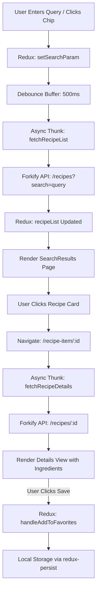

# Savor — Modern Recipe Studio & Finder 🍳✨

[](https://react.dev/)
[](https://redux-toolkit.js.org/)
[](https://vitejs.dev/)
[](https://tailwindcss.com/)
[](https://reactrouter.com/)

**Savor** is a minimalist, editorial-inspired culinary discovery web application designed for food lovers and home chefs. Built with **React 18**, **Redux Toolkit**, and **Tailwind CSS**, it connects to the Forkify API to provide real-time recipe searches, precise ingredient measurements, and an offline-persistent kitchen recipe vault.

---

## 📑 Table of Contents

- [Overview](#-overview)
- [Key Features](#-key-features)
- [Tech Stack](#-tech-stack)
- [Project Architecture & Structure](#-project-architecture--structure)
- [Getting Started & Installation](#-getting-started--installation)
- [Available Scripts](#-available-scripts)
- [How to Use the Application](#-how-to-use-the-application)
- [State Management & Routing Workflow](#-state-management--routing-workflow)
- [API Reference](#-api-reference)
- [Design Philosophy](#-design-philosophy)

---

## 🌟 Overview

Savor eliminates distractions and generic AI templates in favor of a modern, tactile, and professional food editorial aesthetic.

### Why Savor?

- **Fast, Debounced Querying**: Searches automatically fire as you type without spamming unnecessary network calls.
- **Natural Browser History**: Browser **Back** and **Forward** buttons work seamlessly across searches, details pages, and favorites.
- **Persistent Favorites**: Save recipes to your personal recipe box and access them anytime—even after refreshing or closing your browser.
- **Zero Distractions**: Clean typography, delicate micro-animations, glassmorphic headers, and responsive layouts that adapt gracefully to desktop and mobile viewports.

---

## ⚡ Key Features

1. **Intelligent Debounced Search Bar**
   - Live query typing with a 500ms debounce buffer to optimize API requests.
   - Press the `/` key from anywhere on the screen to immediately focus the search input.
   - Quick clear button (`✕`) to wipe the search input and automatically return Home.
   - Immediate form submission on pressing `Enter`.

2. **Curated Culinary Discovery (Home Page)**
   - **Quick Search Tags**: One-tap query buttons for popular ingredients like _Handmade Pasta_, _Artisan Pizza_, _Tender Chicken_, and _Fresh Salads_.
   - **Chef's Featured Spotlight**: High-impact editorial showcase card featuring cooking time, difficulty level, and user ratings.
   - **Curated Flavor Collections**: Thematic visual cards (e.g., _Italian Classics_, _Wood-Fired Pizza_, _Artisan Bakery_) with smooth hover-zoom effects.
   - **Culinary Pillars**: Human-centric feature highlights detailing precision kitchen measurements and the persistent vault.

3. **Cookbook-Grade Recipe Details**
   - High-resolution dish photography and publisher credentials.
   - Serving quantities and estimated cooking times.
   - Formatted ingredient lists featuring exact unit measurements and item descriptions.
   - Direct link to original publisher instructions.
   - One-tap "Save Recipe" / "Remove from Favorites" toggle.

4. **Persistent Recipe Vault (`/favorites`)**
   - Bookmarked recipes are stored directly in `localStorage` via `redux-persist`.
   - Real-time counter badge in the Navbar indicating saved recipe count.
   - Empty state illustration with quick shortcuts to discover recipes.

5. **Fluid Responsive Layout & Mobile Menu**
   - Glassmorphic sticky top navbar with blur backdrop (`backdrop-blur-md`).
   - Mobile-first collapsible navigation drawer.
   - Automatic `ScrollToTop` helper ensuring every page navigation begins at the top.

---

## 🛠️ Tech Stack

| Category             | Technology                                                                                                                                        | Purpose                                                        |
| :------------------- | :------------------------------------------------------------------------------------------------------------------------------------------------ | :------------------------------------------------------------- |
| **Framework & Core** | [React 18](https://react.dev/)                                                                                                                    | Component architecture & Virtual DOM                           |
| **Build Tool**       | [Vite 5](https://vitejs.dev/)                                                                                                                     | Lightning-fast HMR and optimized production bundling           |
| **State Management** | [Redux Toolkit](https://redux-toolkit.js.org/)                                                                                                    | Centralized store, async thunks, and slice reducers            |
| **Persistence**      | [Redux Persist](https://github.com/rt2zz/redux-persist)                                                                                           | LocalStorage hydration for user favorites & search cache       |
| **Routing**          | [React Router DOM v6](https://reactrouter.com/)                                                                                                   | Client-side routing, nested routes, and browser history        |
| **Styling**          | [Tailwind CSS v3](https://tailwindcss.com/)                                                                                                       | Utility-first responsive design and custom animations          |
| **Typography**       | [Plus Jakarta Sans](https://fonts.google.com/specimen/Plus+Jakarta+Sans) & [Playfair Display](https://fonts.google.com/specimen/Playfair+Display) | Contemporary geometric typography with editorial serif accents |
| **Icons**            | [FontAwesome 6](https://fontawesome.com/)                                                                                                         | Crisp SVG culinary and navigation iconography                  |
| **API**              | [Forkify v2 API](https://forkify-api.herokuapp.com/v2)                                                                                            | External recipe catalogue & ingredient payload provider        |

---

## 📁 Project Architecture & Structure

```text
React_Recipe_Finder/
├── public/                     # Static assets
├── src/
│   ├── assets/                 # SVGs and images
│   ├── components/             # Reusable UI components
│   │   ├── Navbar/
│   │   │   └── Navbar.jsx      # Glassmorphic navbar, search input, and mobile drawer
│   │   ├── RecipeItem/
│   │   │   └── RecipeItem.jsx  # Card representation of a single recipe item
│   │   └── ScrollToTop/
│   │       └── ScrollToTop.jsx # Automatic scroll restoration on route changes
│   ├── context/
│   │   └── index.jsx           # Global context reference
│   ├── hooks/
│   │   └── useDebounce.js      # Custom debounce timing hook
│   ├── pages/                  # Page-level view components
│   │   ├── Details/
│   │   │   └── Details.jsx     # Recipe overview, ingredients list, and favorites toggle
│   │   ├── Favorites/
│   │   │   └── Favorites.jsx   # Saved recipe collection (persisted locally)
│   │   ├── Home/
│   │   │   └── Home.jsx        # Editorial hero, quick search chips, and category cards
│   │   └── SearchResults/
│   │       └── SearchResults.jsx # Grid of recipes matching active query with empty states
│   ├── store/                  # Redux Toolkit configuration
│   │   ├── recipeActions.js    # Async thunks for API fetches (`fetchRecipeList`, `fetchRecipeDetails`)
│   │   ├── recipeSlice.js      # Central slice handling search, details, and favorites
│   │   └── store.js            # Redux store configured with redux-persist
│   ├── App.css                 # Default base CSS
│   ├── App.jsx                 # Route definitions and layout wrapper
│   ├── index.css               # Tailwind directives and custom scrollbar styles
│   └── main.jsx                # Application root with Redux Provider & PersistGate
├── .eslintrc.cjs               # ESLint configuration
├── index.html                  # HTML entry point with Google Fonts preconnections
├── package.json                # Project dependencies and npm scripts
├── postcss.config.js           # PostCSS configuration for Tailwind
├── tailwind.config.js          # Extended theme, custom animations, and brand colors
└── vite.config.js              # Vite build setup with Windows sandbox filesystem patch
```

---

## 🚀 Getting Started & Installation

### Prerequisites

Make sure you have Node.js installed on your machine:

- **Node.js**: `v18.0.0` or higher recommended
- **npm**: `v9.0.0` or higher (or pnpm / yarn)

### 1. Clone the Repository

```bash
git clone https://github.com/your-username/React_Recipe_Finder.git
cd React_Recipe_Finder
```

### 2. Install Dependencies

```bash
npm install
```

### 3. Launch the Development Server

```bash
npm run dev
```

Open your browser and navigate to `http://localhost:5173` to view the app.

---

## 📜 Available Scripts

In the project directory, you can run:

| Command           | Action                                                                                       |
| :---------------- | :------------------------------------------------------------------------------------------- |
| `npm run dev`     | Starts the Vite local development server with Hot Module Replacement (HMR).                  |
| `npm run build`   | Compiles and minifies the code for production into the `dist/` directory.                    |
| `npm run preview` | Locally serves the production build created in `dist/` for testing.                          |
| `npm run lint`    | Runs ESLint across all `.js` and `.jsx` files to enforce code cleanliness and zero warnings. |

---

## 💡 How to Use the Application

1. **Find a Recipe**:
   - Type an ingredient or meal into the top navigation bar (e.g., `pasta`, `salmon`, `pizza`). The app automatically searches after you pause typing.
   - Or, click any of the **Quick Search Chips** or **Curated Collection Cards** on the Home page.
   - Press the keyboard shortcut `/` at any time to instantly focus the search bar.

2. **Browse Results**:
   - Results appear dynamically in a responsive 4-column card grid on the `/search` page.
   - Hover over any recipe card to reveal smooth zoom interactions.

3. **Inspect Recipe Details**:
   - Click the image, title, or the **"View Ingredients"** button on any recipe card to open its dedicated page (`/recipe-item/:id`).
   - Review exact measurements, units, serving estimates, and preparation times.
   - Click the **"Back"** button or use your browser's back button to return to your previous search results without losing context.

4. **Bookmark to Your Favorites Vault**:
   - On the recipe details page, click **"Save Recipe"**.
   - Navigate to `/favorites` (or click **Favorites** in the navbar) to view all bookmarked recipes.
   - Favorites persist across browser restarts and device reloads.

5. **Clear Search & Return Home**:
   - Press the `✕` icon inside the search input or delete the search term to return directly to the Home page.
   - Or, click the **Savor** logo or **Home** link in the navbar at any time.

---

## 🔄 State Management & Routing Workflow



---

## 🌐 API Reference

This project integrates with the public **Forkify API v2**:

- **Search Recipes Endpoint**:

  ```http
  GET https://forkify-api.herokuapp.com/api/v2/recipes?search={query}
  ```

  Returns a list of matching recipes including `id`, `title`, `publisher`, and `image_url`.

- **Recipe Details Endpoint**:
  ```http
  GET https://forkify-api.herokuapp.com/api/v2/recipes/{id}
  ```
  Returns full recipe details including cooking time, servings count, source URL, and detailed ingredient breakdowns (`quantity`, `unit`, `description`).

## 📄 License

This project is open-source and available under the [MIT License](LICENSE).
Feel free to fork, customize, and build your own culinary creations! 👨‍🍳👩‍🍳
